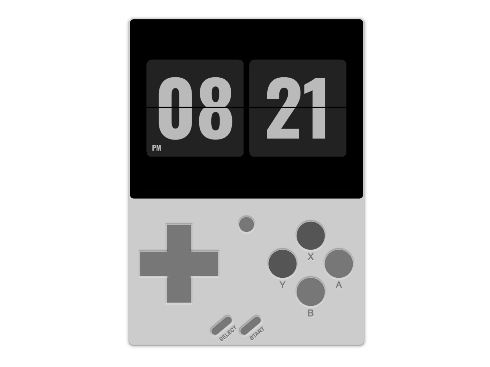

# SDL Flip Clock

A small SDL2 flip clock app for desktop development and Linux-based handheld
game consoles.

The project keeps the core app build separate from distribution-specific
packaging. The root `Makefile` builds only the `flipClock` binary. Each
distribution owns its own packaging flow under `distributions/`.

<p align="center">
  
</p>

## Features

- SDL2-only app runtime
- In-app menu for time testing, 12/24-hour mode, and quit
- OnionOS packaging with bundled SDL2 runtime libraries
- OnionOS sleep prevention handled by the distribution launch script

## Requirements

### Local Build

- `make`
- C compiler
- SDL2
- SDL2_ttf
- `sdl2-config`

On macOS with Homebrew:

```sh
brew install sdl2 sdl2_ttf
```

### OnionOS Build

- Docker
- `make`

The OnionOS build uses `distributions/onionos/Dockerfile`. The Docker image
uses the Miyoo Mini toolchain and installs:

- Miyoo Mini Buildroot toolchain under `/opt/miyoomini-toolchain`
- `steward-fu/sdl2` runtime libraries under `/opt/onionos-sdl2`
- SDL2_ttf and dependent runtime libraries for the target package

## Build

### Local

```sh
make
./output/build/local/binary/flipClock
```

Local build outputs:

```text
output/build/local/binary/flipClock
output/build/local/objects/
```

Clean generated files:

```sh
make clean
```

### Menu Controls

Use the menu to trigger flip animations without waiting for the clock to change:

- <kbd>Esc</kbd>: open or close menu
- <kbd>Up</kbd> / <kbd>Down</kbd>: select menu item
- <kbd>Enter</kbd> / <kbd>Space</kbd>: run selected item

`Set Time` closes the menu and lets you edit while watching the main clock:

- <kbd>Left</kbd> / <kbd>Right</kbd>: switch hour/minute field
- <kbd>Up</kbd> / <kbd>Down</kbd>: change selected value
- <kbd>Space</kbd>: reset to device time
- <kbd>Enter</kbd> / <kbd>Esc</kbd>: apply and leave edit mode

When the edited time is applied, the app runs the hook passed with
`--set-time-hook`. The hook receives the selected time as `HH MM` arguments.

Menu items:

- `Set Time`
- `12-Hour Mode` / `24-Hour Mode`
- `Show FPS` / `Hide FPS`
- `Exit`

## Distribution Builds

Distribution packages are built under `distributions/<name>/`. The root
`Makefile` should not contain distribution packaging rules.

See [distributions/README.md](distributions/README.md) for the distribution
extension points and the responsibilities of each distribution package.

### OnionOS

Build the OnionOS package:

```sh
make onionos
```

Equivalent direct command:

```sh
make -C distributions/onionos package
```

Output:

```text
output/distributions/onionos/FlipClock-v1.2.0.zip
```

The generated zip contains:

```text
FlipClock/
  flipClock
  launch.sh
  set-time.sh
  config.json
  fonts/
  icon/
  lib/
    libSDL2-2.0.so.0
    libSDL2_ttf-2.0.so.0
    libEGL.so
    libGLESv2.so
    libjson-c.so.5
    libfreetype.so.6
    libpng16.so.16
    libz.so.1
    libbz2.so.1.0
    libstdc++.so.6
    libmi_ao.so
    libmi_common.so
    libmi_gfx.so
    libmi_sys.so
    libshmvar.so
```

`launch.sh` sets `LD_LIBRARY_PATH` to `./lib`, creates `/tmp/stay_awake` while
the app runs, and removes it on exit.

OnionOS launches the app as `./flipClock --set-time-hook ./set-time.sh`.
`set-time.sh` applies the selected time to the OnionOS system clock.

## Install On OnionOS

1. Build or download `FlipClock-v1.2.0.zip`.
2. Extract the zip.
3. Copy the extracted `FlipClock` directory to `/App` on the SD card.
4. Boot the device and run `Flip Clock` from Apps.

The app directory must be named `FlipClock`.

## Project Layout

```text
src/                         Core app source
include/                     Core app headers
fonts/                       Bundled font assets
icon/                        OnionOS app icon
config.json                  Runtime configuration
Makefile                     Common SDL2 app build
distributions/local/         Local distribution files
distributions/onionos/       OnionOS Docker build and packaging
output/                      Generated build and package outputs
```

## Notes

- The app links dynamically to SDL2 for OnionOS, but the package bundles the
  target SDL2 runtime libraries under `FlipClock/lib`.
- `distributions/onionos/lib` is intentionally not used. Runtime libraries are
  staged only under `output/package/onionos/FlipClock/lib` before zipping.
- Build outputs are separated by profile under `output/build/<profile>/`.
  Local builds use `local`; OnionOS Docker builds use `onionos`.
- Future handheld distributions should add their own directory under
  `distributions/` and keep their packaging rules there.

## Changelog

### v1.2.0

- Moved the app to SDL2-only builds.
- Added the in-app menu, FPS toggle, and manual time edit mode.
- Added optional `--set-time-hook` support for distribution launchers.
- Split build outputs by profile under `output/build/<profile>/`.
- Reworked OnionOS packaging with Docker-based builds and bundled SDL2 runtime libraries.
- Updated the OnionOS launcher, time hook, and app icon.

### v1.1

- Added 12/24-hour mode toggle with <kbd>Start</kbd>.
- Improved rendering performance.

### v1.0

- Initial flip clock release.
- Added OnionOS awake handling and quit shortcut.
